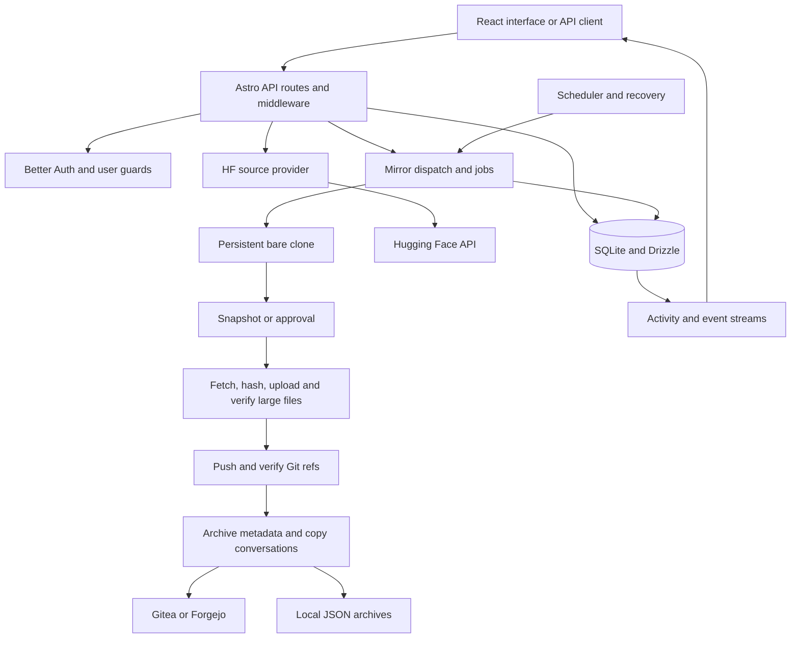

# HF Mirror — Architecture

HF Mirror is an Astro server application with React interfaces and a Bun
runtime. SQLite stores state through Drizzle. It derives from
[RayLabsHQ's gitea-mirror](https://github.com/RayLabsHQ/gitea-mirror), retaining
authentication, configuration, activity, scheduling, and recovery foundations
while implementing a Hugging Face source and a push-based backup pipeline.

## Request and transfer flow



The production runtime wrapper applies `BASE_URL` and delegates to Astro's
generated handler. Middleware resolves sessions or bridges proxy headers,
initializes environment configuration, runs recovery, and starts background
cleanup and scheduling. Process shutdown callbacks stop background services.

Discovery queries models, datasets, Spaces, organizations, likes, and configured
collections. It stores imported rows without transferring repository contents.
Source identity includes host, repository type, owner/name, and connection
association. Connections carry their own encrypted token; the source used by a
repository is checked before credentials are supplied to Git.

## Backup pipeline

The database-aware push wrapper records progress, jobs, destination identity,
errors, and completion. The lower-level engine performs Git work:

1. Obtain a per-clone lock and a process-wide transfer slot.
2. Create or update the persistent bare clone, fetch branches and tags, and map
   HF `refs/pr/*` to `refs/hf-mirror/pr/*`.
3. Ensure the destination repository exists and matches the source provenance
   and privacy requirements. Refuse archived destinations.
4. Compare the destination's refs with the source. Snapshot prior history or
   pause for approval according to the chosen protection strategy.
5. Fetch all historical LFS-backed files, verify local hashes and sizes, upload
   them in bounded batches, and check destination LFS download availability.
6. Push refs, pruning removed refs. Retry readiness and supported batch cases,
   then compare the destination's refs with the desired set.
7. Record the transfer manifest and update the advertised default branch.
8. Archive HF metadata and selected discussions; update destination issues and
   comments using markers to avoid duplicates. Mark the job complete only after
   selected work succeeds.

LFS can be excluded explicitly. In that case the manifest and status report the
exclusion. HF PR conversations become issues, while their Git refs are retained
under a dedicated namespace. Source credentials and destination credentials stay
separate; remote LFS URLs are explicitly set rather than trusting a repository's
own endpoint configuration.

## Persistence

| Tables | Responsibility |
| --- | --- |
| `users`, `sessions`, `accounts`, verification tables | Identity, sessions, local/external credentials |
| `configs` | Per-user source preferences, destination, schedules, cleanup, notifications |
| `sources` | Multiple named HF connections and encrypted tokens |
| `repositories` | Source/type identity, state, destination, overrides, progress, errors |
| `organizations` | Discovery state, source pins, destination and mirror overrides |
| `mirror_jobs`, `events` | Job lifecycle, progress/activity and event-stream records |
| `sso_providers`, OAuth/JWK tables | Login provider and authorization-server state |
| `api_keys`, `rate_limits` | Programmatic access and rate-limit tracking |

The authoritative schemas are [schema.ts](../src/lib/db/schema.ts) and ordered
[SQL migrations](../drizzle/). Runtime initialization creates the SQLite file and
applies pending migrations, with compatibility repair paths for prior schemas.
Avoid manual schema edits. `DATABASE_URL` controls the app's database location.

Clones normally live beside the database under `mirrors/HOST/OWNER/` with a name
including repository type and source ID. JSON archives use the database
repository ID; safety bundles use a hash of source identity. The persistent
clone also carries LFS files needed by historical safety bundles.
See [backup and restore](./backup-restore.md).

## Project map

```text
src/
|-- components/        React views, forms, tables, UI primitives
|-- pages/             Astro pages and API routes
|-- layouts/           Astro layout
|-- hooks/             Auth, configuration, filtering, and live updates
|-- lib/
|   |-- db/            Schema, SQLite setup, migration repair
|   |-- source-providers/ HF API adapter and discovery
|   |-- push-engine/   Git/LFS transfer, locks, snapshots, destinations
|   |-- providers/     Notification delivery
|   |-- sso/           OIDC configuration
|   `-- utils/         Mapping, encryption, schedules, URL validation
|-- tests/             Bun preload and API route regressions
`-- types/             Domain and API types
scripts/               Database, environment, runtime, recovery, validation
drizzle/               SQL migrations and journal
tests/container-e2e/   Production-container test harness and fixtures
```

The supported deployment is one application process owning its SQLite and
persistent clone storage. Scheduler state and transfer limits are process-local;
the repository does not provide a distributed worker/queue deployment. More
boundaries are in [roadmap](./roadmap.md).
